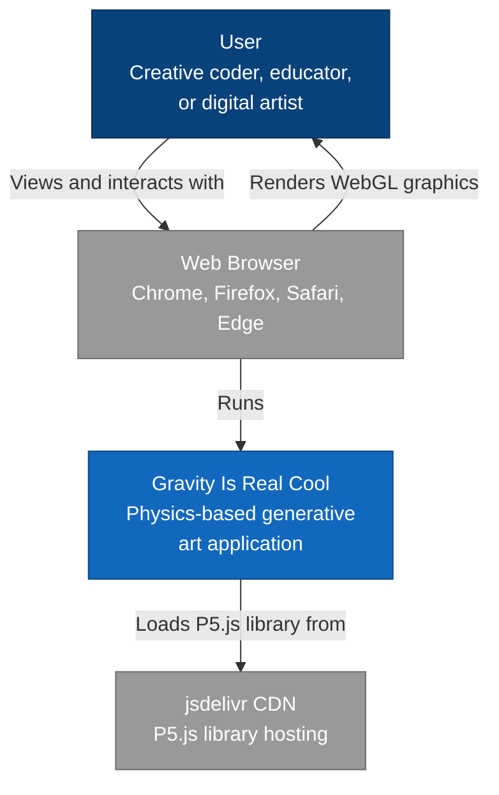
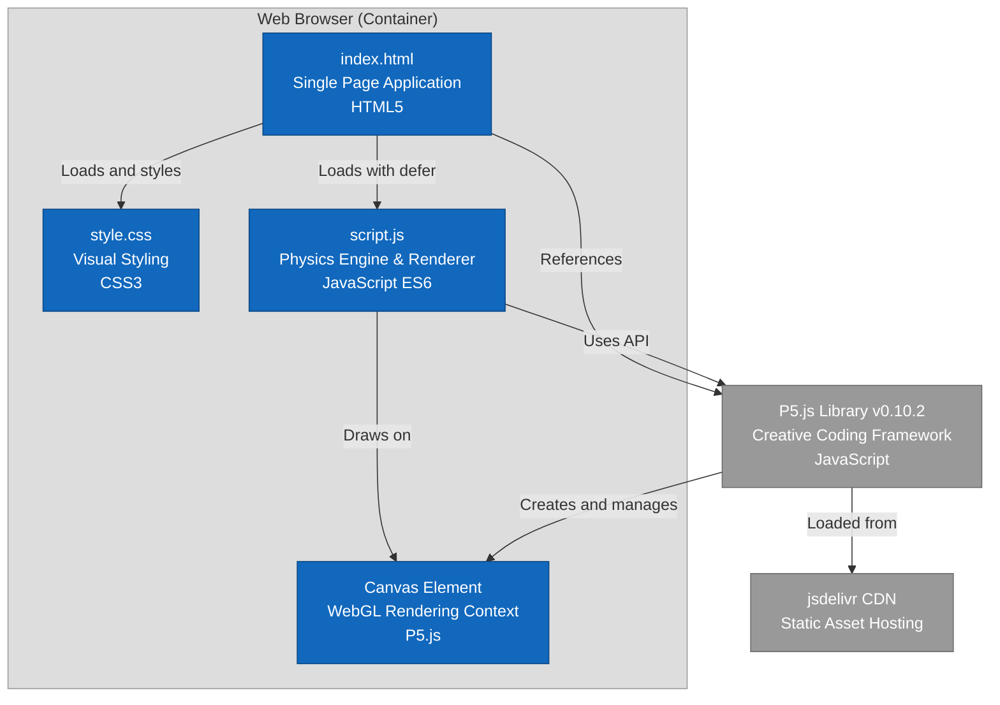
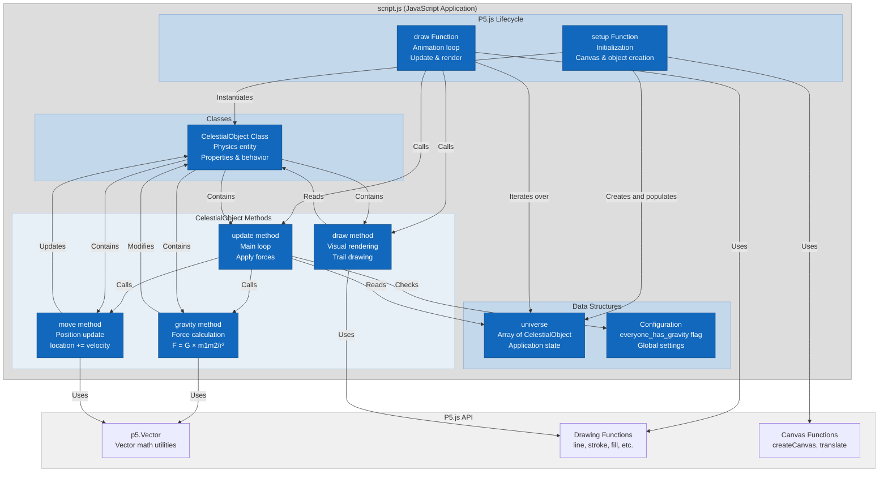
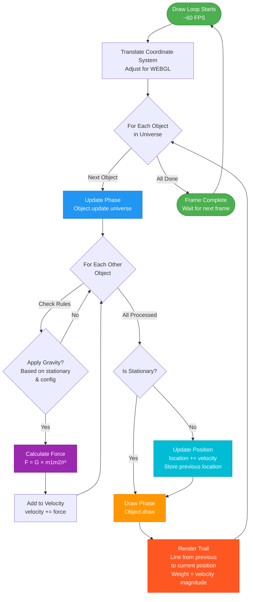
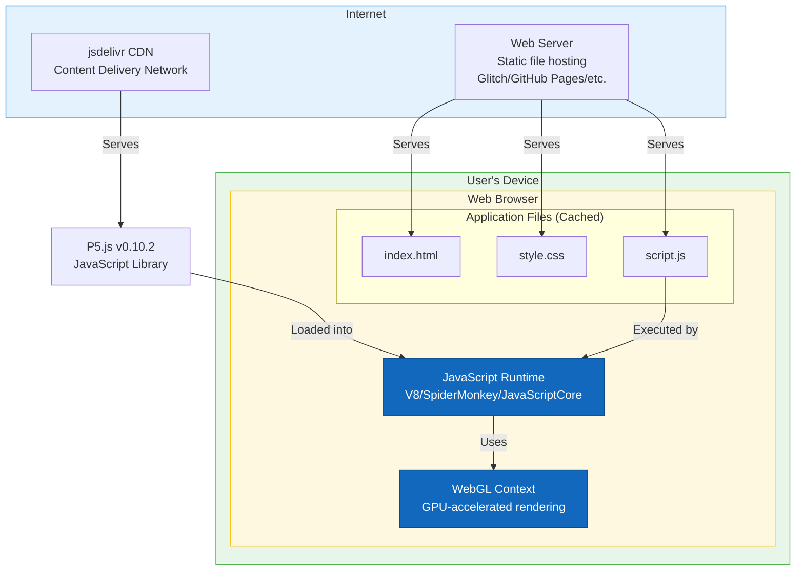

# C4 Architecture Diagrams

This document provides C4 model architectural diagrams for the "Gravity Is Real Cool" project using Mermaid syntax.

## Context Diagram

The system context shows how the application fits into its environment and interacts with users.

**Key Relationships**:
- **User → Browser**: User opens the application in their web browser
- **Browser → System**: Browser loads and executes the JavaScript application
- **System → CDN**: Application fetches P5.js library (v0.10.2) from jsdelivr CDN
- **Browser → User**: Browser renders the visual output using WebGL

## Container Diagram

The container diagram shows the high-level technical building blocks of the application.

**Containers**:

1. **index.html** (HTML Document)
   - Technology: HTML5
   - Responsibility: Application entry point, loads dependencies
   - Loads: P5.js from CDN, local script.js, style.css

2. **style.css** (Stylesheet)
   - Technology: CSS3
   - Responsibility: Visual styling (minimal - black background)
   - Size: 11 lines

3. **script.js** (JavaScript Application)
   - Technology: JavaScript ES6
   - Responsibility: Physics engine, simulation logic, rendering
   - Size: 132 lines
   - Contains: CelestialObject class, setup(), draw(), universe state

4. **Canvas Element** (Rendering Surface)
   - Technology: WebGL via P5.js
   - Responsibility: Hardware-accelerated graphics rendering
   - Created by: P5.js createCanvas() with WEBGL mode

5. **P5.js Library** (External Dependency)
   - Technology: JavaScript library v0.10.2
   - Responsibility: Canvas abstraction, vector math, animation loop
   - Source: jsdelivr CDN

## Component Diagram

The component diagram shows the internal structure of script.js, the main application logic.

**Component Details**:

### Data Structures
- **universe**: Global array storing all CelestialObject instances (both stationary wells and moving particles)
- **everyone_has_gravity**: Configuration flag determining gravity behavior

### Classes
- **CelestialObject**: Encapsulates physics entity with properties (location, velocity, mass) and methods (gravity, move, update, draw)

### P5.js Lifecycle Hooks
- **setup()**: Called once at initialization, creates canvas and populates universe
- **draw()**: Called ~60 times per second, updates physics and renders

### CelestialObject Methods
- **gravity(obj)**: Calculates gravitational force from another object using inverse square law
- **move()**: Updates position based on accumulated velocity
- **update(objs)**: Main update loop applying forces from all relevant objects
- **draw()**: Renders visual representation (trails for moving objects)

## Data Flow Diagram

This diagram shows how data flows through the system during the animation loop.

**Flow Description**:

1. **Frame Start**: P5.js calls draw() at approximately 60 FPS
2. **Coordinate Adjustment**: Translate coordinate system for WEBGL mode
3. **Object Loop**: Iterate through all objects in universe array
4. **Physics Update**: For each object, calculate gravitational forces from other objects
5. **Force Calculation**: Apply inverse square law for qualifying object pairs
6. **Velocity Update**: Accumulate forces into velocity vector
7. **Position Update**: Move non-stationary objects based on velocity
8. **Rendering**: Draw line from previous to current position with velocity-based weight
9. **Repeat**: Continue to next object until all processed
10. **Frame Complete**: Wait for next frame, repeat infinitely

## Deployment Diagram

Shows how the application is deployed and accessed by users.

**Deployment Notes**:

- **Static Hosting**: Application can be hosted on any static file server (GitHub Pages, Netlify, Glitch, etc.)
- **No Build Step**: Files served as-is, no compilation or bundling required
- **CDN Dependency**: Relies on jsdelivr CDN for P5.js library
- **Client-Side Only**: All processing happens in user's browser
- **GPU Acceleration**: WebGL provides hardware-accelerated rendering
- **Cross-Platform**: Works on any device with modern browser and WebGL support
